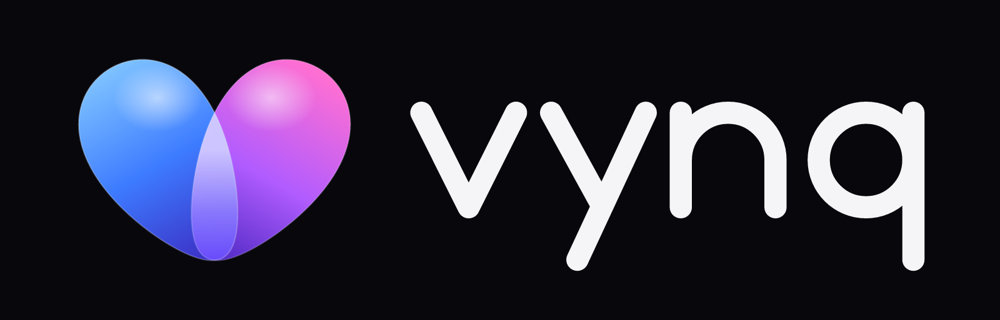

<p align="center"></p>

# vynq: REAL CONNECTIONS

A private, premium messaging and video-calling app for a small circle of trusted people. Native Android (Kotlin/Compose) and iOS (SwiftUI). Accounts use email, never phone numbers. Messaging is end-to-end encrypted, and video quality comes first.

> **Status: Phase 1 (brand + app shell).** No messaging, calling or accounts work yet. See [`docs/04-roadmap.md`](docs/04-roadmap.md) and [`DEVLOG.md`](DEVLOG.md).

## Repository
| Path | What |
|---|---|
| `android/` | Android app (`app`) + design system (`core/designsystem`) |
| `brand/` | Logo generator, master SVGs, exports, tokens, guidelines |
| `docs/` | Environment, architecture, threat model, data model, roadmap, accounts, Fusion Mode |
| `.github/workflows/` | CI: Android build + unit tests |

## Build (Windows)
Requirements: JDK 17, Android SDK (platform 36). See [`docs/00-environment.md`](docs/00-environment.md).
```powershell
cd android
.\gradlew.bat assembleDebug testDebugUnitTest
adb install -r app\build\outputs\apk\debug\app-debug.apk
.\gradlew.bat recordRoborazziDebug      # JVM screenshots → app/build/outputs/roborazzi
```
`local.properties` (SDK path, later API endpoints) is git-ignored. **Never commit secrets, keystores, `google-services.json` or `.env` files.**

## Key documents
- [Architecture & technology decisions](docs/01-architecture.md)
- [Threat model](docs/02-threat-model.md)
- [Accounts & infrastructure you'll need](docs/05-accounts-and-infrastructure.md)
- [Brand guidelines](brand/BRAND.md)

## Licence
The vynq apps are licensed under the [GNU Affero General Public License v3.0 or later](LICENSE), because messaging encryption uses libsignal (AGPL-3.0). The "vynq" name and logo are brand assets and are not licensed for others to use as their own branding.
